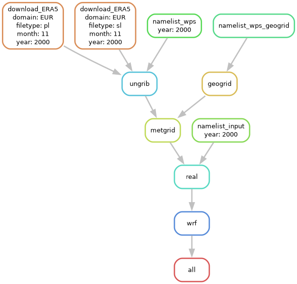

# Snakemake WRF Workflow

This repository contains a Snakemake workflow to run a WPS/WRF simulation.

The main workflow is defined in `workflow/Snakefile`. It reads `config/config.yaml`, where
the run years, ERA5 domain, input/output directories, WPS/WRF installation paths,
template namelists, and table names are configured. The Snakefile uses those
values to build the WPS and WRF steps: namelist generation, geogrid, ERA5
download, ungrib, metgrid, real, and wrf.

The workflow features automated metadata generation for each workflow run leveraging
[RO-Crate metadata packaging solution](https://www.researchobject.org/ro-crate/).

## Configuration

Edit `config/config.yaml` before running the workflow. The most important values
are:

- `runs`: years to simulate; `run_dir`: per-year directory template.
- `ERA5.domain` and `ERA5.grib_basedir`: ERA5 domain and GRIB directory.
- `geog_data.path` and `geog_data.url`: geographical data directory and download URL.
- `ERA5.download_script` and `geog_data.download_script`: download scripts, with paths resolved like the other configured paths.
- `execution.runtime_script` and `execution.mpi_launcher`: runtime environment and MPI launcher.
- `WPS.install_dir` and `WRF.install_dir`: existing software installations.
- `WPS.namelist_template` and `WRF.namelist_template`: Jinja2 namelist templates.
- `WPS.geogrid`: `geo_em_path`, `table`, `tasks`, and `mem_mb_per_cpu`.
- `WPS.ungrib`: `vtable` and `mem_mb_per_cpu` (always one task).
- `WPS.metgrid`: `table`, `tasks`, and `mem_mb_per_cpu`.
- `WRF.real` and `WRF.wrf`: `tasks` and `mem_mb_per_cpu`.

For example, the WRF resources are configured as:

```yaml
WRF:
  install_dir: "wrf_installation/WRFV4.6.1"
  namelist_template: "config/templates/toy_example/namelist.input"
  real:
    tasks: 4
    mem_mb_per_cpu: 2000
  wrf:
    tasks: 16
    mem_mb_per_cpu: 2000
```

Each MPI task uses one CPU. Missing resource settings default to one task and
2000 MB per CPU (10000 MB for ungrib). With one task, the executable runs directly;
with multiple tasks, it uses the configured MPI launcher and `-n` task count.

Relative paths are resolved against `repo_root_custom`, or the working directory
when omitted. The `{era5_domain}` placeholder in `WPS.geogrid.geo_em_path` is
expanded using `ERA5.domain`; `{year}` in `run_dir` is expanded for each run.
The previous flat configuration keys are no longer used.

### WPS/WRF Compilation

Keep `enable_compilation: false` and provide existing installations through
`WPS.install_dir` and `WRF.install_dir`. Adapting the external compilation module
to the nested configuration is pending. The existing `compilation_repo`,
`compilation_version`, and `compilation_config` settings are retained for that
future integration.

## Examples

There are two example configurations in the repository. The current `Snakefile`
is intended to be used with the `toy_example` templates in
`config/templates/toy_example/`. This example runs a light WRF simulation over
only a few days.

The ERA5 helper `workflow/scripts/ERA5/retrieve_era5_days4_6.py` was created for the toy example
to reduce the workflow runtime by downloading only the required days.

## Workflow Execution

This project uses [Pixi](https://pixi.prefix.dev/) to manage its environment and execute workflows via automated tasks. Make sure to [install Pixi](https://pixi.prefix.dev/latest/installation/) before continuing.

### 1. Running Locally

To validate the workflow structure or run small test domains on your local machine:

```bash
# Dry run to preview the execution plan
pixi run dry-run

# Execute locally using all available cores
pixi run run-local
```

*Note: If you need to append extra Snakemake arguments, like targeting a specific rule or requesting a fixed number of cores, you can pass them directly at the end of the command, for example: `pixi run run-local --cores 4`*

### 2. Running on HPC

HPC cluster configurations and Slurm scheduler flags are decoupled from the scientific code using *Git Worktrees* to ensure project portability.

- **Step 2.1: Embed the HPC profile**

Initialize the cluster infrastructure `hpc-profiles` branch into your local profiles directory. For instance, adding Altamira cluster profile configuration will be done through:

```bash
git worktree add config/profiles hpc-profiles
```

The command above will populate `config/profiles/` with the available cluster configurations (e.g., `altamira/`), each containing its own Slurm presets and a `set_env.sh` file.

- **Step 2.2: Launch the Simulation**

To execute the workflow, use the unifed Pixi's `hpc-profile` task. **Pass the name of the HPC profile as the first argument**, followed by any optional Snakemake flags:

```bash
# Standard execution on Altamira
pixi run hpc-profile altamira

# Dry-run execution on Altamira
pixi run hpc-profile altamira --dry-run

# Execution limiting concurrent Slurm jobs
pixi run hpc-profile altamira --jobs 15

# Run on Altamira while tracking metadata provenance via RO-Crate
pixi run hpc-profile altamira --workflow-profile ro-crate
```

*Note: As described in the local execution section, any extra Snakemake argument is passed directly to the pixi task. However, Slurm-related settings are defined through the profile configuration under `profiles/<profile>/config.yaml`*

*Note: For cluster-specific validations (like checking NetCDF paths via ldd on Altamira), please refer to the internal documentation at `config/profiles/<profile>/README.md` after mounting the worktree.*

### 3. Working with HPC profiles (Git Worktree)

Once the Git Worktree is set up, any update in the configuration of any HPC profile will work as follows:

- **Download configuration updates**:

```bash
cd config/profiles/altamira
git pull origin hpc-profiles
```

- **Upload configuration changes**:

```bash
cd config/profiles/altamira
# E.g. modify config.yaml...
git add config.yaml
git commit -m "Increase memory limits for WRF simulation"
git push origin hpc-profiles
```

## Advanced workflow management

Run the following commands from the repository root, using the same configuration
and working directory as the original execution. Direct `snakemake` commands
require the workflow environment to be active (for example, via `pixi shell`).

### Run all simulations through ungrib

Set the simulation years in `config/config.yaml`:

```yaml
runs: [2000, 2001, 2002, 2003]
```

Use `--until ungrib` with the default workflow target to run through `ungrib`
for all configured years, including the required dependencies. Snakemake stops
before the downstream `metgrid`, `real`, and `wrf` steps.

With Pixi:

```bash
# Preview the jobs
pixi run run-local --until ungrib --cores 4 --dry-run

# Execute locally
pixi run run-local --until ungrib --cores 4
```

With Snakemake directly:

```bash
snakemake --until ungrib --cores 4 --dry-run
snakemake --until ungrib --cores 4
```

For Slurm, use the HPC profile so that jobs receive the cluster settings and
runtime environment:

```bash
pixi run hpc-profile altamira --until ungrib --jobs 15

# Equivalent direct execution in an active workflow environment
source config/profiles/altamira/set_env.sh
snakemake --profile config/profiles/altamira --until ungrib --jobs 15
```

To continue through WRF later, repeat the appropriate execution command without
`--until ungrib`. Snakemake reuses up-to-date results. The configured years do
not imply full-year ERA5 coverage: the current Snakefile requests November,
and the default toy-example download script retrieves only days 4–6.

### Monitor an execution from another terminal

Snakemake's `--summary` displays output files, their status, and whether they
need to be created or updated. It inspects files and metadata; it does not
connect to the running scheduler or show live job progress.

```bash
# With Pixi
pixi run snakemake --summary --nolock

# With Snakemake directly
snakemake --summary --nolock

# Refresh the summary every 10 seconds
watch -n 10 'pixi run snakemake --summary --nolock'
```

Use `--detailed-summary` instead of `--summary` to include input files and shell
commands. Add `--until ungrib` to restrict the summary to the same execution
scope. Files being written may still be incomplete, so this summary is not a
count of successfully completed jobs. `--nolock` lets this inspection avoid
locking the working directory; use it here only for inspection.

For live progress messages, completed-job counts, and errors, follow the log
of the running execution. This command selects the most recent Snakemake log;
select the specific log path instead if several executions are present:

```bash
tail -n 50 -f "$(ls -t .snakemake/log/*.snakemake.log | head -n 1)"
```

Press `Ctrl+C` to stop following the log without stopping the workflow.

For Slurm executions, inspect queued and running jobs separately:

```bash
watch -n 5 "squeue -u $USER"
```

`PD` means pending and `R` means running. The bundled HPC profiles store job
logs under `logs/slurm/`. Snakemake has no built-in `snakemake status` command
that attaches to an already running execution.

See the [Snakemake command-line documentation](https://snakemake.readthedocs.io/en/stable/executing/cli.html)
for the summary and execution options.

## DAG

The workflow DAG is shown below. The repository also includes the PDF version in
`dag.pdf`.



Regenerate it with:

```bash
snakemake --dag | dot -Tpdf > dag.pdf
snakemake --dag | dot -Tpng > dag.png
```

## TODO

- Decide how to protect the workflow from missing control files due to storage
  problems such as partition unmounts.
- Create a Snakefile to run CORDEX in Altamira. The main difference is that the
  domain is provided as an argument.
- Decide which symbolic links are created by default and which are provided by
  the user. For example, `GEOGRID.TBL` and `METGRID.TBL` are provided by the
  user, but `Vtable` is created by default. The user can provide a custom
  `Vtable` if desired.
- Download `geog_data.path` from
  https://www2.mmm.ucar.edu/wrf/site/access_code/geog_data.html if it is not
  available.
- Improve `workflow/scripts/ERA5/retrieve_era5.py` to support days as an argument. Decide how to
  handle this in the Snakefile.
- Ask Josipa if it would be possible to clean the WRF/run template folder.
  Decide how to deal with the excludes:
  `/gpfs/projects/meteo/WORK/ASNA/projects/cordex-core/02_SAM12_evaluation/rundir/WRFv4.6.1-cordex_core/run/`.
